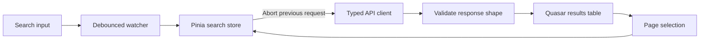

# Vue movie search

A focused Vue and TypeScript assessment project for searching a public movie catalogue. It demonstrates debounced input, typed API validation, request cancellation, paginated results, explicit UI states, and deterministic browser tests.

The application queries the HackerRank movie-search API by title and presents results through Quasar components. Pinia owns request state so the view stays declarative and stale responses cannot overwrite a newer search.

## Search workflow



The interface distinguishes its initial, loading, empty, success and error states. Changing the query resets pagination, while changing the page keeps the active title. Each new request aborts the previous one to avoid out-of-order updates during fast typing or navigation.

## Run locally

Use a Node.js version compatible with the `engines` field in `package.json`, then install and start the Vite development server:

```bash
npm install
npm run dev
```

Open `http://localhost:5173`.

Additional project commands:

```bash
npm run type-check
npm run lint
npm run build
npm run preview
```


## Design boundaries

### Typed API client

`src/api/moviesClient.ts` builds requests from a fixed HTTPS origin and validates pagination metadata and every movie entry before returning typed data. Invalid status codes, JSON, or response shapes become a `MoviesApiError` rather than leaking unchecked values into the UI.

### Request ownership in Pinia

`src/stores/moviesSearch.ts` owns the active `AbortController`, query, page, result set and status. Components trigger intent; they do not reproduce networking rules.

### Debounced search

`src/composables/useDebouncedWatch.ts` delays API work until input settles. Cancellation and debouncing solve different problems: debouncing limits calls, while cancellation protects state if an older call is already in flight.

### UI states

`MovieSearchView.vue` keeps loading, failure, empty results and pagination visible at the presentation boundary. Quasar supplies the layout and table primitives; Sass contains the project-specific styling.

## Tests

Unit-test source covers:

- API input validation, URL construction, response parsing and abort-signal forwarding;
- Pinia search state, pagination, failures and cancellation;
- application shell rendering.

Playwright source covers the browser search workflow with a mocked API, keeping the scenario deterministic and independent of public-service availability.

```bash
# Single Vitest run
npm run test:unit -- --run

# Install Playwright browsers once, then run e2e tests
npx playwright install
npm run test:e2e
```

The tests establish behavior against mocks and fixtures, not the uptime or correctness of the external HackerRank service.

## Repository map

```text
src/api/                  Typed HTTP client and API tests
src/stores/               Pinia request state and store tests
src/composables/          Debounced watcher
src/views/                Search, results and pagination UI
src/router/               Application route
src/__tests__/            App-shell test
e2e/                      Mocked Playwright workflow
```

## Technology

Vue 3 Composition API, TypeScript, Pinia, Quasar, Vite, Sass, Vitest and Playwright.

## Scope

This repository is a front-end assessment implementation. It intentionally uses a public read-only API and does not include authentication, a persistence layer, movie details, saved searches or production analytics.
